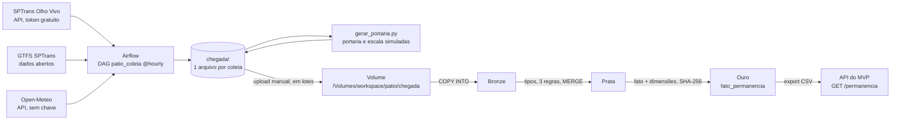

# 🚌 Pátio Monitor | Big Data Architecture & Data Integration

### Global Solution 2026.2 — FIAP
**Tema: CitizenTech | Pipeline de dados do Pátio Monitor**

## 👥 Integrantes

| Nome | RM |
|---|---|
| Camila do Prado Padalino | 98316 |
| Felipe Cavalcante Bressane | 97688 |
| Gabriel Teixeira Machado | 551570 |

🌐 **MVP no ar:** https://patio-monitor-gs-97688.azurewebsites.net · 🗂️ **Repositório do MVP e do deploy:** [patio-monitor-devops](https://github.com/FeBressane/patio-monitor-devops)

---

## 🧾 Ficha Técnica do MVP

| Campo | Pátio Monitor |
|---|---|
| Nome do produto | Pátio Monitor |
| Cidadão e território | O passageiro que espera na plataforma e o controlador de terminais e garagens de ônibus em São Paulo. O Terminal Pirituba é o cenário de referência. |
| Problema | Escala, portaria e rastreamento não concordam sobre onde está cada ônibus, e o controlador decide sem saber se o veículo está fora, manobrando ou foi trocado. |
| Proposta de valor | Uma visão única do pátio que cruza o previsto com o registrado e aponta pendências enquanto ainda dá tempo de agir. |
| Arquitetura | Front web, API do produto, pipeline de dados (Airflow → Databricks, **este repositório**), Smart Bus Gate (ESP32), automação RPA no n8n, assistente de IA e detector de visão, publicados por CI/CD em nuvem. |
| Fontes de dados | SPTrans Olho Vivo (posições reais), GTFS da SPTrans (viagens previstas), Open-Meteo (clima) e portaria simulada em CSV, com a regra de geração documentada. |
| Modelos de IA | Assistente do controlador com LLM e RAG, YOLO para veículos no pátio e o modelo de Machine Learning do Smart Bus Gate. |
| URL do MVP e repositório | https://patio-monitor-gs-97688.azurewebsites.net · https://github.com/FeBressane/patio-monitor-bigdata |
| Indicadores de impacto | Porcentagem de partidas no horário, tempo para localizar um veículo, saídas sem confirmação por dia e tempo médio de permanência. |
| ODS | ODS 11 (meta 11.2, transporte público acessível e eficiente) e ODS 9 (infraestrutura e inovação). |

## 📌 O produto em uma frase

O **Pátio Monitor** é uma visão única do pátio de ônibus que cruza o que estava previsto (escala) com o que aconteceu de fato (portaria e GPS) e aponta as pendências enquanto ainda dá tempo de agir.

Este repositório é o componente **Dados** do MVP: o pipeline que coleta as posições reais dos ônibus em volta do **Terminal Pirituba**, trata tudo em camadas **Bronze → Prata → Ouro** no Databricks e entrega ao produto a tabela de permanência que o controlador vê.

## ❓ Perguntas que o MVP responde

1. Quais veículos estão no pátio agora, e há quanto tempo?
2. Quais viagens previstas não têm saída confirmada?
3. Onde a escala, a portaria e o GPS discordam?
4. A porcentagem de partidas no horário melhorou depois dos alertas? (impacto)

## 🔄 Arquitetura (da fonte ao MVP)



O Databricks Free Edition não se conecta ao Airflow, então os arquivos de `chegada/` sobem ao Volume pela interface, em lotes de dias diferentes.

## 📊 Fontes de dados

| Fonte | Origem | Formato | Frequência de coleta |
|---|---|---|---|
| Posições dos ônibus | API **SPTrans Olho Vivo** (`/Posicao`), filtrada num raio de 1,5 km do Terminal Pirituba | JSON | De hora em hora |
| Viagens previstas | **GTFS da SPTrans** (`trips`, `stop_times`, `routes`) | CSV | Diária |
| Clima | API **Open-Meteo** (chuva e temperatura por hora), fonte complementar para cruzar chuva com atraso | JSON | Diária |
| Portaria e escala | **Simuladas** a partir das posições reais, com regra fixa e semente fixa ([`scripts/gerar_portaria.py`](scripts/gerar_portaria.py)) | CSV | Diária |

Por que simular a portaria: não temos acesso à portaria nem à escala de veículos de uma garagem real. O GTFS diz quais viagens existem, mas não qual ônibus faz cada uma. A regra de geração (janelas de entrada e saída, ruído de 8% sem saída, 5% de veículo trocado, 5% de vaga errada, 2% de saída antes da entrada e motoristas fictícios) está documentada no topo do script.

## 🗂️ Estrutura do repositório

| Pasta | Conteúdo |
|---|---|
| [`dags/`](dags/) | DAG `patio_coleta` do Airflow |
| [`databricks/`](databricks/) | Notebooks `01_bronze`, `02_prata`, `03_ouro` e as consultas `04_consultas.sql` |
| [`amostras/`](amostras/) | Um pouco de cada fonte, sem token e sem dado pessoal |
| [`scripts/`](scripts/) | Gerador da portaria e da escala simuladas |
| [`airflow/`](airflow/) | Docker Compose do Airflow local |

## ⚙️ O pipeline, etapa por etapa

| Requisito | Onde está | Como foi feito |
|---|---|---|
| 01 · Fontes | tabela acima | 3 fontes reais (2 APIs públicas e 1 base aberta) e 1 simulada documentada |
| 02 · DAG agendado | [`dags/patio_coleta.py`](dags/patio_coleta.py) | `@hourly`, `catchup=False` (a Olho Vivo só devolve o "agora"), 1 arquivo por coleta com data e hora no nome (`olhovivo_20261113_2000.json`) |
| 03 · Paralelismo, verificação e chaves | idem | `coletar_olho_vivo`, `coletar_gtfs` e `coletar_clima` rodam em paralelo, e depois `conferir_chegada` valida os arquivos. O token fica na Variable `sptrans_token`. Falhas disparam **notificação** (`on_failure_callback`): no log e, se a Variable `alerta_webhook_url` existir, num webhook |
| 04 · Lotes no Volume | `/Volumes/workspace/patio/chegada` | Upload pela interface em pelo menos 2 lotes de dias diferentes |
| 05 · Bronze incremental | [`databricks/01_bronze.py`](databricks/01_bronze.py) | `COPY INTO` por fonte: no 2º lote só os arquivos novos entram, e rodar de novo não duplica. O notebook mostra as contagens antes e depois |
| 06 · Prata | [`databricks/02_prata.py`](databricks/02_prata.py) | Tipos corrigidos, deduplicação e `MERGE` pela chave (`prefixo_veiculo`, `data_hora`). 3 regras com o total barrado por cada uma: **R1** coordenada fora do raio do pátio, **R2** prefixo nulo ou fora do formato de 5 dígitos, **R3** saída registrada antes da entrada |
| 07 · Ouro + 5 consultas | [`databricks/03_ouro.py`](databricks/03_ouro.py), [`databricks/04_consultas.sql`](databricks/04_consultas.sql) | Fato `fato_permanencia` e as dimensões `dim_veiculo`, `dim_linha`, `dim_tempo` e `dim_local`. Consultas: permanência média por linha, viagens sem saída confirmada por dia, veículos parados há mais de X minutos, divergências escala × portaria por tipo e o **impacto** (% de partidas no horário antes e depois dos alertas) |
| 08 · LGPD e MVP | `03_ouro` + API do MVP | Matrícula e nome do motorista (fictícios) chegam à Ouro só como **SHA-256**. O MVP usa a `fato_permanencia`, exportada sem nenhuma coluna de motorista: a API a serve em `GET /api/permanencia` e a tela do MVP mostra a seção "Permanência no pátio (camada Ouro)" |
| 09 · README | este arquivo | Integrantes, arquitetura e passo a passo |

## ▶️ Como reproduzir o pipeline

**1. Coleta (Airflow)**

Ferramenta: **Apache Airflow 3** (3.3.2, modo standalone). Pré-requisitos: Docker Desktop e um token gratuito da SPTrans (https://www.sptrans.com.br/desenvolvedores/, área "Meus aplicativos").

```bash
cd airflow
cp .env.example .env            # coloque o SPTRANS_TOKEN e a AIRFLOW_ADMIN_SENHA (o .env fica fora do Git)
docker compose up -d            # Airflow 3 em http://localhost:8081 (usuário admin)
```

Baixe o GTFS no portal da SPTrans e salve como `airflow/gtfs/gtfs.zip`. Sem ele, a tarefa de GTFS é pulada com aviso e a coleta de posições continua.
No Airflow, ative o DAG `patio_coleta`. Cada execução grava os arquivos em `chegada/`.

**2. Portaria e escala simuladas** (depois de ter coletas de pelo menos 2 dias)

```bash
python scripts/gerar_portaria.py chegada chegada
```

**3. Databricks (Free Edition)**

1. Crie o Volume `workspace.patio.chegada` (o notebook `01_bronze` também cria).
2. Suba os arquivos de `chegada/` pela interface. O 1º lote é de um dia, o 2º lote é de outro dia.
3. Rode `01_bronze` → `02_prata` → `03_ouro` → `04_consultas`. Rode o `01_bronze` de novo, sem arquivo novo, para provar que nada duplica.

**4. Entrega ao MVP**

Baixe o resultado da última célula do `03_ouro` como CSV e salve em `data/ouro/fato_permanencia.csv` no [repositório do MVP](https://github.com/FeBressane/patio-monitor-devops). O deploy publica o arquivo, e a API o serve em `GET /permanencia`.

## 🔐 Segurança e LGPD

- 🔑 Nenhum token no código nem no repositório: o token da SPTrans fica no `.env` local, chega ao Airflow como Variable (`AIRFLOW_VAR_SPTRANS_TOKEN`) e aparece mascarado (`***`) nos logs.
- 👤 Os únicos dados pessoais do domínio (matrícula e nome do motorista) são **fictícios** e chegam à Ouro só como hash SHA-256. O export usado pelo MVP não tem nenhuma coluna de motorista.
- 📁 A pasta `chegada/` com os dados brutos fica fora do Git. O repositório leva só `amostras/`.

## 🌍 Contribuição para CitizenTech

Com a posição real dos ônibus cruzada com a escala e a portaria, o controlador sabe na hora quais ônibus estão no pátio, há quanto tempo e quais viagens ainda não saíram. Isso reduz o tempo para localizar um veículo e ajuda a aumentar a porcentagem de partidas no horário, o que contribui para o **ODS 11.2** (transporte público acessível e eficiente) e para o **ODS 9**.

## 🔗 Links do projeto

- **MVP Pátio Monitor:** https://patio-monitor-gs-97688.azurewebsites.net
- **Tabela da Ouro no MVP:** https://patio-monitor-gs-97688.azurewebsites.net/api/permanencia
- **Repositório do MVP e do deploy (DevOps):** https://github.com/FeBressane/patio-monitor-devops

---

**FIAP — Global Solution 2026.2**

**Pátio Monitor | CitizenTech**
